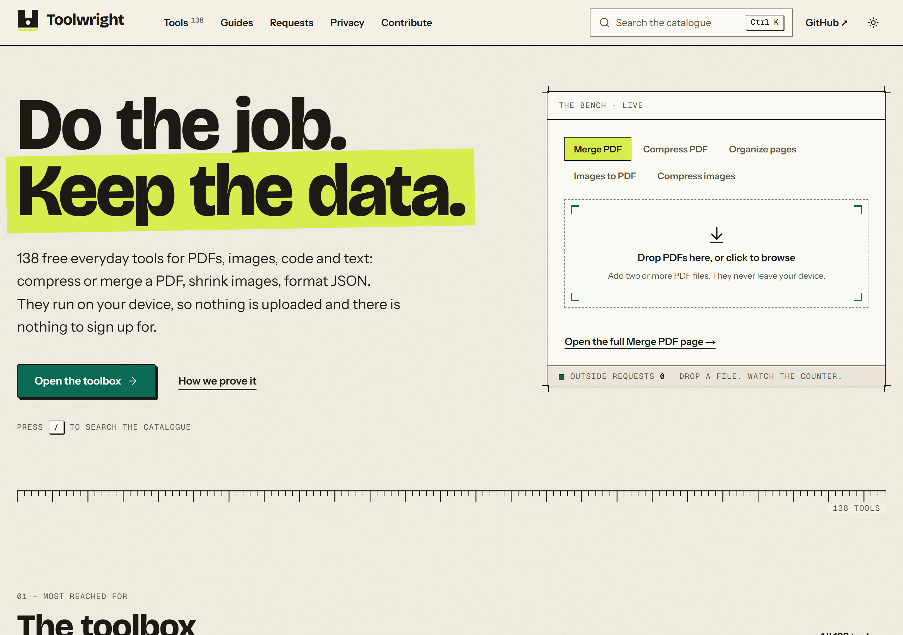
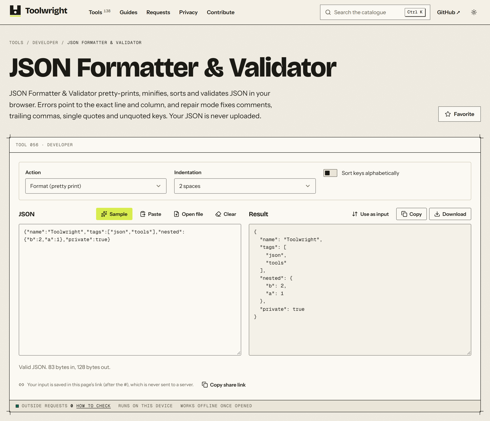
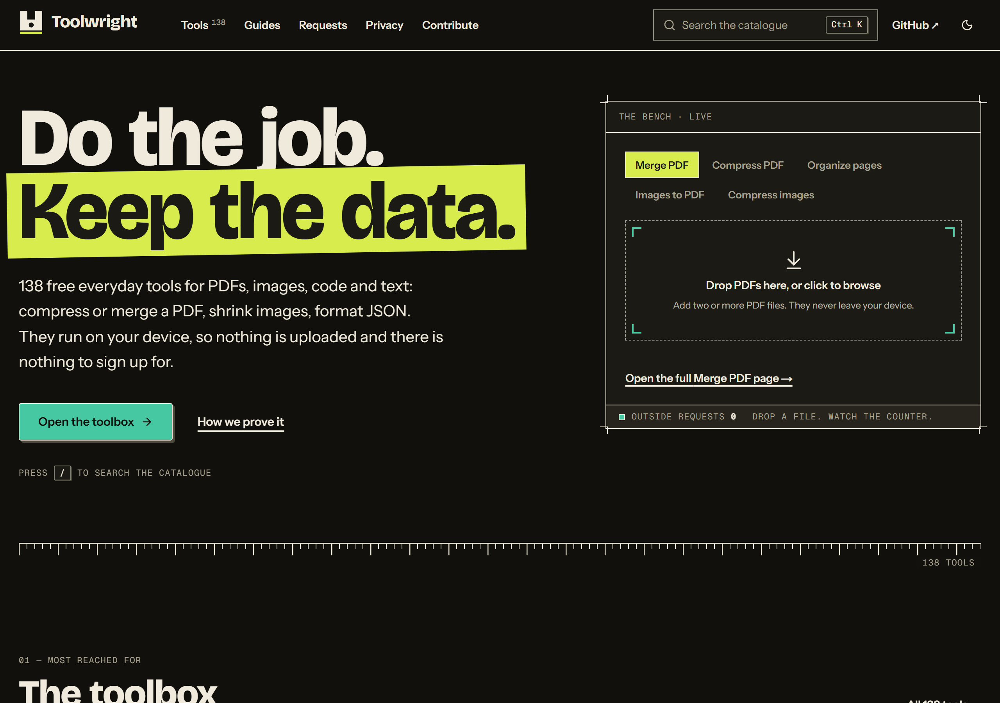

# Toolwright

**Live site: [toolwright.com](https://toolwright.com)**

**Do the job. Keep the data.** Free, open-source tools that never see your data.

Toolwright is a collection of 138 everyday tools for PDFs, images, code and text. Format JSON, merge PDFs, compress images, generate passwords, decode JWTs and more. **Every tool runs in your browser.** Nothing you type or drop in is uploaded and there are no accounts. A Content Security Policy (`connect-src 'self'`) stops page code from sending your input to another site, and you can check that yourself in the browser's Network tab.

[Open the site](https://toolwright.com) · [Browse the tools](docs/tools.md) · [How privacy works](docs/privacy-model.md) · [Request a tool](https://toolwright.com/requests) · [Contribute](CONTRIBUTING.md)



<p>
  
  
</p>

## Why

Most "free online tools" quietly upload your files to a server, wrap them in ads or trials, and tell you to trust them. Modern browsers are powerful enough to do the work locally, so Toolwright does, and makes that **verifiable** instead of just promised.

- **Private by construction.** Tools run client-side. A Content Security Policy (`connect-src 'self'`) enforces it, and end-to-end tests fail if a tool makes an outside request or transmits its input.
- **Free without catches.** No sign-up, watermarks or daily quotas. The only size limits are your device's memory and a few explicit caps that each tool page states.
- **Open source (MIT).** Read the code, fix a bug, or add the tool you wish existed. Each tool is one folder.
- **Accessible and fast.** Keyboard friendly, screen-reader labelled, light and dark themes, WCAG A/AA audited in CI, installable as an app, and usable offline once opened.

## How it looks

Toolwright looks like **a tool catalogue kept by a careful workshop**: warm paper and ink, a patina-green accent, a highlighter-lime marker, numbered ledger rows instead of card grids, and a live *network ledger* that counts the requests your browser made to other sites (it should read 0). No gradients, glows or pill badges, by rule and by test. The reasoning is in [docs/design-language.md](docs/design-language.md); tokens and components are in [docs/design-system.md](docs/design-system.md).

## What's inside

138 tools in nine drawers, the same grouping as [toolwright.com/tools](https://toolwright.com/tools):

| Drawer | Tools | Examples |
| --- | ---: | --- |
| **Developer** | 34 | JSON formatter & validator, JSON diff, JWT decoder and signer, regex tester, cron explainer, SQL formatter, Unix timestamp converter, JSON to TypeScript, XML formatter, IP & subnet calculator, Mermaid editor, SVG sanitizer, SVG to React |
| **PDF** | 32 | Merge, split, compress, rotate, crop, organize, edit, sign, redact, protect and unlock, fill forms, compare, flatten, sanitize, grayscale, N-up, booklet, page numbers, watermark, PDF to images and text |
| **Calculators** | 16 | Units, percentages, dates, time zones, loans and mortgages, compound interest, number bases, salary to hourly |
| **Image** | 14 | Compressor, compress to a target size, converter, resizer, crop / rotate / flip, EXIF viewer and remover, SVG to PNG, image to SVG, GIF maker and editor, APNG maker |
| **Text** | 13 | Word counter, diff checker, case converter, find & replace, sort and dedupe lines, Markdown preview, HTML to Markdown, readability score |
| **Color & design** | 11 | Color converter, WCAG contrast checker, palette generator, QR codes (static, never expire), favicon generator, SVG optimizer, editor, recolor and shape generator |
| **Encoders & hashes** | 8 | Base64, URL and HTML entity encoding, hash generator (MD5/SHA/HMAC), hex/binary, string and Unicode escaping |
| **Generators** | 6 | Passwords & passphrases, UUID / ULID / NanoID, lorem ipsum, barcodes, Data Matrix, PDF417 |
| **Data converters** | 4 | JSON to CSV, JSON to YAML, CSV delimiters, CSV to Markdown table |

See the [full catalogue](docs/tools.md). Missing something? [Request a tool](https://toolwright.com/requests) or build it.

## Getting started

Requirements: **Node.js 22.13 or newer** (PDF.js and Mermaid need it) and **pnpm 11.5** (the version pinned in `packageManager`; `corepack enable` picks it up).

```bash
git clone https://github.com/RaydanAridiCS/toolwright.git
cd toolwright
pnpm install
pnpm dev             # http://localhost:3000
```

### Everyday commands

| Command | What it does |
| --- | --- |
| `pnpm dev` | Start the Next.js dev server |
| `pnpm run build` / `pnpm start` | Production build and server |
| `pnpm test` | Unit and component tests (Vitest) |
| `pnpm run test:coverage` | Same, with a coverage report |
| `pnpm run e2e` | End-to-end tests (Playwright, runs against a production build) |
| `pnpm run lint` / `pnpm run typecheck` | ESLint and TypeScript |
| `pnpm run new-tool <slug>` | Scaffold a new tool |
| `pnpm run docs:tools` | Regenerate [docs/tools.md](docs/tools.md) |
| `pnpm run docs:seo` | Regenerate [docs/keyword-map.md](docs/keyword-map.md), the keyword and intent map |
| `pnpm run screenshots` | Regenerate the images in `docs/images` (needs a running production server) |
| `pnpm run e2e:visual` | Optional visual snapshots (per-OS baselines, not run in CI) |
| `pnpm run db:generate` | Generate a SQL migration after changing the database schema |

First time running the end-to-end tests? Install the browser once: `pnpm dlx playwright install chromium`.

## Project layout

```
apps/web/             Next.js app (App Router): pages, SEO, layout, command palette, PWA, API routes
packages/core/        Pure TypeScript logic for every tool. No React, no DOM, no network. Heavily unit-tested.
packages/ui/          Shared UI kit and the TransformTool building block
packages/tools/       One folder per tool: meta.ts (what the site needs) + Tool.tsx (the UI)
packages/db/          Drizzle schema, repositories and service for the tool-request board
scripts/              Registry generator, new-tool scaffold, docs generator
e2e/                  Playwright tests: privacy guarantees, real file workflows, accessibility, offline
docs/                 Architecture, design language, guides and reference (docs/images holds the screenshots)
```

Read [docs/architecture.md](docs/architecture.md) for how the pieces fit together. How the site is made findable in search and answer engines, honestly and without any tracking, is in [docs/seo.md](docs/seo.md).

## Adding a tool

```bash
pnpm run new-tool my-tool-name -- --name "My Tool" --category developer
```

This scaffolds the metadata, UI, logic and tests, and registers the tool. Then follow [docs/writing-a-tool.md](docs/writing-a-tool.md). For simple text-in/text-out tools the whole UI is about 20 lines.

## Request a tool

Suggest a tool or vote on ideas on the [request board](https://toolwright.com/requests). No account is needed. The most-voted ideas get built first.

## Follow along

New tools and short how-tos are posted here:

<!-- Placeholder handles: replace @toolwright once the accounts exist. -->
- YouTube: [@toolwright](https://www.youtube.com/@toolwright)
- Instagram: [@toolwright](https://www.instagram.com/toolwright)
- TikTok: [@toolwright](https://www.tiktok.com/@toolwright)

## Privacy model in one paragraph

Tools do their work in your browser. The site sets `Content-Security-Policy: connect-src 'self'`, so page code cannot reach any other origin. Optional share links keep your input in the URL *fragment* (after `#`), which browsers never send to servers. The only data that reaches the server is what you deliberately submit to the request board (an idea you typed plus a one-way hash of an anonymous browser code). Details and a 60-second way to verify it yourself are in [docs/privacy-model.md](docs/privacy-model.md).

## Tech stack

Next.js 16 (App Router) · React 19 · TypeScript · Tailwind CSS 4 · Bricolage Grotesque, Instrument Sans and Geist Mono (self-hosted) · Drizzle ORM + Postgres (request board only) · Vitest + Testing Library · Playwright + axe-core · pnpm workspaces

## Contributing

Contributions of every size are welcome. Read [CONTRIBUTING.md](CONTRIBUTING.md) and our [Code of Conduct](CODE_OF_CONDUCT.md). Security issues: see [SECURITY.md](SECURITY.md).

## License

[MIT](LICENSE) © Toolwright contributors
