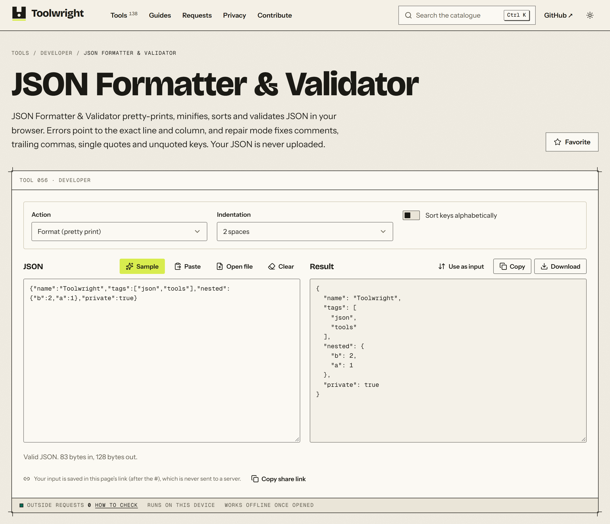

# Design system

The *how* of the "Workshop Ledger" look: tokens, type, shape, components, motion and the rules that keep it consistent. For the concept and reasoning read [design-language.md](design-language.md) first.

All tokens live in `apps/web/src/app/globals.css`. Components live in `packages/ui/src` (generic) and `apps/web/src/components` (site-specific). **Always use tokens and components; never raw hex values or gradients.**

## Color tokens

Defined as CSS variables on `:root` (light "paper") and `.dark` (dark "ink"), exposed to Tailwind (`bg-card`, `text-muted-foreground`, `border-border`, `bg-marker`…).

| Token | Light | Dark | Use |
| --- | --- | --- | --- |
| `background` | `#F4F0E6` | `#12110D` | Page (paper) |
| `foreground` | `#1B1A15` | `#EFEADB` | Text and strong rules (ink) |
| `card` | `#FBF9F3` | `#1B1A15` | Sheets: panels, inputs, plates |
| `muted` | `#EAE5D8` | `#26241D` | Wells, table heads, hover fills |
| `muted-foreground` | `#5B574A` | `#A8A28F` | Secondary text, label plates |
| `border` | `#CFC8B4` | `#38352C` | Hairline rules |
| `primary` | `#0B6B55` | `#46C9A3` | Actions, links, focus (patina green) |
| `primary-foreground` | `#FBF9F3` | `#12110D` | Text on primary |
| `secondary` / `secondary-foreground` | `#E3DDCB` / `#1B1A15` | `#2C2A22` / `#EFEADB` | Quiet buttons |
| `accent` | `#0B6B55` | `#46C9A3` | Alias of primary (kept for compatibility) |
| `marker` / `marker-foreground` | `#D8EC4E` / `#1B1A15` | `#D8EC4E` / `#1B1A15` | Highlighter; **text on it is always ink** |
| `ring` | `#0B6B55` | `#46C9A3` | Focus outline |
| `success` | `#236B2B` | `#7FD48A` | Status |
| `warning` | `#6F5700` | `#E3C34A` | Status |
| `danger` | `#A8261D` | `#F0847B` | Status |
| `ink` (`--shadow-ink`) | `#1B1A15` | `#4A463A` | Hard shadow color |

### Contrast (verified by `apps/web/tests/tokens.test.ts`)

Every text pair below is tested at ≥ 4.5:1 in **both** themes; ink-on-marker at ≥ 7:1; form-control borders and the focus ring at ≥ 3:1.

| Pair | Light | Dark |
| --- | --- | --- |
| foreground / background | 15.3:1 | 15.7:1 |
| muted-foreground / background | 6.4:1 | 7.4:1 |
| primary / background | 5.7:1 | 9.1:1 |
| primary-foreground / primary | 5.7:1 | 9.1:1 |
| marker-foreground / marker | 13.3:1 | 13.3:1 |
| warning / background | 6.1:1 | 11.0:1 |
| danger / background | 6.2:1 | 7.5:1 |

### Rules

- **No gradients, no glows, no blur.** Anywhere. (Enforced by `design-rules.test.ts`.)
- **No purple, indigo, violet, pink or orange**, in tokens, classes or hex literals in source. (Enforced.)
- **Marker = background behind ink text.** Use `bg-marker text-marker-foreground`. Never lime text, never lime on light text.
- **Status colors are for status.** Use them via `Alert` and `Badge`.
- **Dark theme**: same structure, warm near-black. Shadows become a lighter ledge so the press affordance stays visible. The marker and the mark's underline stay lime.

## Typography

| Class / token | Face | Used for |
| --- | --- | --- |
| `font-display` (`--font-display`) | Bricolage Grotesque (variable, wght 200–800, optical sizing) | Headlines, ledger names, numerals, panel titles |
| `font-sans` (`--font-body`) | Instrument Sans (variable, wght 400–700) | Body and UI |
| `font-mono` (`--font-mono`) | Geist Mono (variable) | Data, results, code, `label-plate` |

`h1`, `h2`, `h3` use the display face by default with `letter-spacing: -0.022em`, `word-spacing: 0.04em` and `text-wrap: balance`.

| Role | Size |
| --- | --- |
| Home headline | `clamp(2.9rem, 8.2vw, 7rem)`, weight 800, leading 0.9, tracking −0.03em |
| Page H1 (tool, catalogue, category, prose) | `clamp(2.4rem, 5.6vw, 4.6rem)` and similar, weight 800 |
| Section H2 | `text-4xl sm:text-5xl`, weight 800 |
| Ledger name | 24–28px display, weight 700 |
| Body | 15.5px base (`text-[16.5px]` in long-form), leading 1.55 |
| Form label | 13px, weight 600, sentence case |
| `label-plate` | 11px mono, uppercase, +0.08em, muted |

Fonts are loaded with `next/font/local` from the `@fontsource-variable/*` and `geist` woff2 files in `app/layout.tsx` (same-origin, so the CSP `font-src 'self'` holds). Only Latin subsets ship; Geist Mono is `preload: false` because it is used for small text.

## Shape and elevation

- **Radius** is re-mapped in `@theme` so every existing `rounded-*` utility is sharp: `sm 2px`, `md/lg 3px`, `xl/2xl 4px`, `3xl 6px`. `rounded-full` is for true circles only (ticket notches).
- **Rules, not boxes**: surfaces are separated by 1px hairlines (`border-border`) and strong ink rules (`border-foreground`).
- **Elevation**: `shadow-sm`/`xs`/`2xs` are `none`; `shadow-md` is `3px 3px 0 0 var(--shadow-ink)`, `lg` 4px, `xl` 6px, `2xl` 8px. A hard shadow means "you can press this" (primary buttons, `ResultSlab`, the ticket).
- **Paper grain**: `body::before` draws a tiny inline-SVG noise at 5% (light) / 3.5% (dark) opacity, fixed, non-interactive.

## Components

### `packages/ui` (generic)

| Component | Notes |
| --- | --- |
| `Button`, `buttonClasses()` | Variants `primary` (green, ink border, hard shadow at `md`/`lg`, presses flat), `secondary`, `outline` (marker on hover), `ghost` (marker on hover), `danger`. Sizes `sm` `md` `lg` `icon`. Icon-only buttons **must** have `aria-label`. |
| `Field` + `Input` / `Textarea` / `Select` | `Field` wires the label to the control. Controls have a visible `border-foreground/55` border (≥ 3:1). Use `mono` for data. |
| `Toggle` | A native checkbox with `role="switch"`: square track, square thumb, green when on. |
| `SegmentedControl` | Radio group as ledger tabs; the active choice is `bg-marker`. 2–4 mutually exclusive modes. |
| `Badge` | Square mono outline stamp: `neutral`, `primary`, `success`, `danger`. Never a filled pill. |
| `Alert` | Ruled note with a colored left bar. Errors use `role="alert"`. |
| `Panel` | Section with a display-font title and an actions row. |
| `Stat` / `StatGrid` | Ledger cells that share borders; mono label above, display numerals below. |
| `ResultSlab` | The headline answer of a calculator: raised slip, large display numerals. `size="md"` for sentences. Pass `valueTestId` for tests. |
| `Plate` + `StatusLine` | The tool frame: ruled caption strip, content, crop marks, footer strip. |
| `ScrollArea` | Scrollable, keyboard-focusable, labelled region (required for any scrolling box). |
| `Kbd` | Keycap with a 1px hard shadow. |
| `CopyButton`, `DownloadButton`, `FileDropzone`, `FileListItem` | Standard actions. The drop zone is a real `<input type="file">` with registration brackets in the corners; dragging fills it with the marker. |
| `TransformTool` | Input → options → output tool. |
| `useShareableState` | State mirrored into the URL hash; supports `exclude` for secrets. |

### `packages/tools/src/shared` (PDF tools)

| Piece | Notes |
| --- | --- |
| `usePdfSource` | Loads one PDF (`load`) or a batch (`loadMany`, `all`, `remove`); `source` is the first file. Picks up a handed-off file on mount. |
| `PdfDrop` / `PdfBatchDrop` / `PdfSourceList` | One-file drop zone; many-file drop zone ("Add more PDFs" once files are in); the batch as removable file rows. |
| `runOnAll` | Runs one job per file and returns one PDF or one ZIP (`BatchOutput`, spread into `DownloadResult`). |
| `DownloadResult` + `ContinueWith` | The success slab (left success bar). PDF results add a dashed rule and "Continue with this file:" with four outline buttons and a "More tools…" select. |
| `PdfLoadStatus` + `useLockedPdfs` | The load error, then a prompt for each password-protected file: a ruled box with a marker left bar, the file name, a `PasswordField`, "Open PDF" and "Skip this file"/"Cancel". `usePdfSource` includes the queue; Merge and Compress use `useLockedPdfs` directly. |
| `PasswordField` | `Field` + password `Input` + an outline icon button "Show …" with `aria-pressed`. |
| Edit PDF editor (`tools/edit-pdf`) | A `role="toolbar"` of icon buttons (`aria-pressed`, the active one `primary`), a fixed-height hint line so the page never moves when the tool changes, the page in a `bg-muted` frame with an SVG overlay (selection: dashed `--ring` outline and square handles in `--card`), and a side panel with the properties of the selected edit and the list of edits on the page (the selected row in `marker`). Tool messages go in the side panel, not above the page. |
| `SheetSidePreview` + `SheetPager` | A sheet of paper (`bg-white`, `border-foreground`, the sheet's aspect ratio) with page pictures placed and turned exactly where the PDF puts them, an optional thin border round each page, and a caption; below it, outline chevron buttons round a mono "Sheet 2 of 7". Used by N-up PDF and the Booklet Maker (front and back side by side). |
| `PdfPageSelector`, `PageThumb` / `useThumbnails` | Page grids with lazy PDF.js previews; selected-to-delete pages use the `danger` frame. |

### `apps/web/src/components` (site-specific)

| Component | Notes |
| --- | --- |
| `Ledger` / `catalogueNumber()` | Numbered ruled rows; one stretched link per row, the favorite star above it; marker sweeps on hover/focus. Options: `glyphs`, `sequential`, `showCategory`, `compact`. |
| `ToolGlyph` | Drawn specimen for 12 featured tools; lucide fallback in the same frame. Decorative (`aria-hidden`). |
| `Ruler` | Decorative tick-mark divider with an optional scale label. |
| `NetworkLedger` + `useOutsideRequests()` | Live count of outside requests from Resource Timing; "…" until measured; red if non-zero. |
| `home/HeroBench` | The real Merge PDF, Compress PDF, PDF Page Organizer, Images to PDF and Image Compressor tools, lazy-loaded into tabs on the home page (through `ToolLoader` with `track={false}`). |
| `home/ProofLog` | The page's real request log plus the "Try to make it leak" demo. |
| `home/Ticket` | "Tool 072 is yours to name": the request-board entry point; prefills `/requests?title=`. |
| `Logo` / `LogoMark` | Flat mark and wordmark, themed. |
| `SiteHeader`, `MobileMenu`, `SiteFooter`, `CommandPalette` | Chrome. Solid paper header with an ink rule; mobile menu is a full-screen numbered index; palette selection is marked with lime. |

### CSS utilities (`globals.css`)

| Class | Effect |
| --- | --- |
| `.marker` | Lime highlighter swipe behind a phrase (animated; ink text) |
| `.label-plate` | 11px mono uppercase caption |
| `.ledger-row`, `.ledger-muted`, `.ledger-shift` | Row hover marker sweep; muted text darkens; name nudges right |
| `.rise` (with `--i`) | Staggered entrance |
| `.tick` | Digit tick animation |
| `.checker` | Transparency checkerboard (no gradient) for image previews |
| `.skeleton` | Pulsing block |
| `.prose-tw` | Long-form typography (68ch measure) |

## Motion

| Motion | Spec |
| --- | --- |
| Headline rise | 0.7s `cubic-bezier(.2,.8,.2,1)`, translateY(16px) → 0, 70ms stagger via `--i` |
| Marker swipe | 0.7s, scaleX 0 → 1 from the left, 0.45s delay, −1° rotation |
| Ledger hover | 0.22s marker sweep + 8px nudge |
| Button | 0.15s; lifts 1px with a larger shadow on hover, presses 3px flat on active |
| Meter | 0.35s digit tick on change |
| Reduced motion | All animation/transition durations collapse to ~0 |

## Accessibility rules

- **Label in name (WCAG 2.5.3)**: visible text is the accessible name; only icon-only controls get `aria-label`.
- **State is never color alone**: pair with an icon, text or the left bar.
- **Scrolling regions** use `ScrollArea`.
- **Focus**: `:focus-visible` is a 3px `--ring` outline, offset 2px; `forced-colors` uses `Highlight`.
- **Targets**: controls are ≥ 40px tall; the mobile menu rows are ≥ 64px.
- **Decoration** (crop marks, ruler, glyphs, brackets) is `aria-hidden`.
- **Live regions**: results use `aria-live="polite"` sparingly; errors use `role="alert"`.

## Enforcement

| Check | Where |
| --- | --- |
| No gradients / blur / glow / gradient text / oversize radius / padded pills / purple / orange / marketing filler; hero structure | `apps/web/tests/design-rules.test.ts` |
| Token contrast (AA) in both themes, warm paper, sharp radius, hard shadows | `apps/web/tests/tokens.test.ts` |
| No orange in tokens | `apps/web/tests/config.test.ts` |
| WCAG A/AA axe audit, 22 pages × light and dark | `e2e/a11y.spec.ts` |
| Computed styles on the home page contain no gradient/blur/backdrop-filter; no eyebrow chip | `e2e/home.spec.ts` |
| Visual snapshots (manual, per-OS baselines) | `e2e/visual.spec.ts` (`pnpm run e2e:visual`) |

Screenshots in the docs are generated by `pnpm run screenshots` (needs a running production server).
